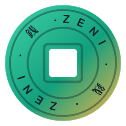

  

<h1 align="center">ZeniPlatform</h1>

  <b>El launcher que te frena antes de tiltear.</b> 
  Tus juegos de Steam, Epic, Riot y Xbox en un solo lugar, con rango y LP de League of Legends, 
  stop-loss, límite de ranked y tus streamers de Twitch y Kick en vivo.

  
  
   
  Windows 10 y 11 · Gratis · Se actualiza solo · <a href="https://zeni-platform.cl">zeni-platform.cl</a> · <a href="https://github.com/ZeniPlatform/Zeni-releases/releases">Todas las versiones</a>

---

## 📥 Cómo instalar

1. Descarga **ZeniPlatform-setup.exe** con el botón de arriba.
2. Ábrelo. Si Windows muestra *"Windows protegió su PC"*, toca **Más información → Ejecutar de todas formas**. Aparece porque Zeni es una app nueva sin certificado de Windows; las actualizaciones sí van firmadas.
3. ¡Listo! Desde ahí, Zeni te avisa de cada versión nueva y se actualiza con un clic.

## ✨ Qué hace

- 🎮 **Una sola biblioteca** con tus juegos de Steam, Epic, Riot y Xbox.
- 🏆 **Rango y LP** de League of Legends siempre a la vista, con tus partidas de hoy.
- 🛑 **Stop-loss y límite diario**: te avisa antes de jugar otra ranked cuando vas en racha de derrotas.
- 🔴 **En vivo**: tus streamers de Twitch y Kick, y el stream se abre dentro de Zeni.
- 📊 **OP.GG, U.GG, LoLalytics y Tracker.gg** sin salir de la app.
- ☁️ **Tu Zeni en cualquier PC**: ajustes, favoritos e historial sincronizados (cuenta opcional).

## 💬 ¿Un error o una idea?

Dentro de Zeni, en la barra lateral, toca **Enviar comentarios**. Leemos todos los mensajes.

## ☕ Apoya a Zeni

  

ZeniPlatform es **gratis para jugadores y siempre lo será**: sin anuncios y sin vender tus datos. Si te sirve, una donación ayuda a mantener el servidor, sumar funciones nuevas y arreglar errores rápido. ¡Gracias por jugar con Zeni! 🎮💚

---

Este repositorio solo contiene los instaladores publicados. © 2026 ZeniPlatform. Todos los derechos reservados.

ZeniPlatform isn't endorsed by Riot Games and doesn't reflect the views or opinions of Riot Games or anyone officially involved in producing or managing Riot Games properties. Riot Games, and all associated properties are trademarks or registered trademarks of Riot Games, Inc. Steam, Epic Games, Xbox, Twitch, Kick y Discord pertenecen a sus respectivos dueños; ZeniPlatform no está afiliado a ninguno de ellos.
